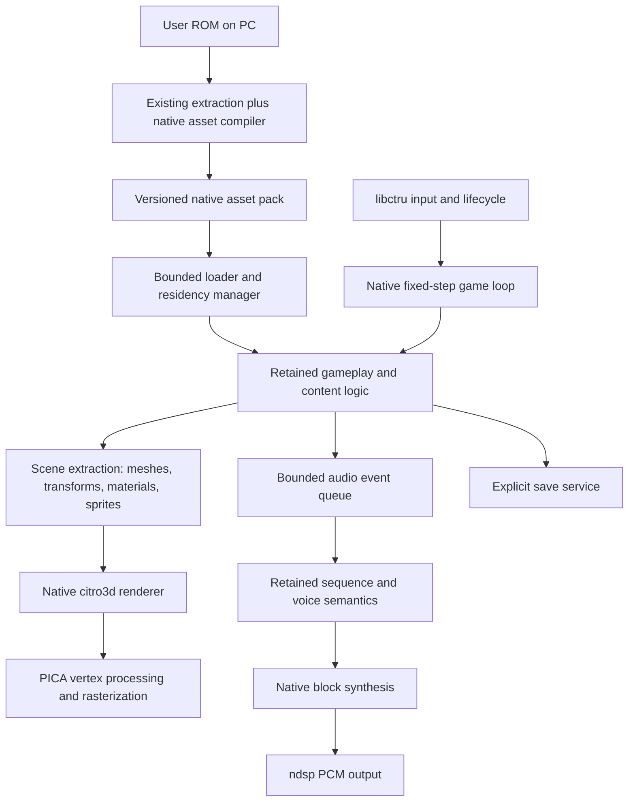

# Native 3DS runtime architecture

Status: proposed implementation plan, 2026-10-14. Baseline: `535cf40297a0`.
No native runtime implementation or hardware performance claim accompanies this plan.

## 1. Objective and boundaries

Build a game-specific native 3DS runtime around F-Zero X's existing gameplay code.
The primary target is original 3DS at its normal clock, with 60 Hz presentation
and original simulation timing, preserving the original game's visual presentation.
The ambition is to recover enough headroom for better textures, effects and draw
distance. Additional visual reductions are not part of the baseline acceptance
target; a reduced profile may be used as a labeled diagnostic experiment.
Cover graphics, assets, scheduling, audio, memory, saves, and platform lifecycle.
Deliver the replacement in independently testable stages.

The target is a feasibility question until an integrated OG hardware slice passes.
Use the measured refresh period rather than assuming exactly 60.000 Hz, and retain
the game's established relationship between simulation ticks and elapsed time.
Do not slow simulation, reduce the number of active racers, or change physics to
make a frame-rate counter meet the target. New3DS may enable optional stereo and
higher quality, but no extra application core is required for correctness or for
the OG performance acceptance run.

Baseline quality means the original game's intended resolution/aspect, machine LOD
selection, draw distance, shadows, effects and HUD behavior. Preserve stock LOD
and culling; disable the port's extra rival-detail reductions for baseline tests.
Material approximations required by different hardware are explicitly compared
and documented, rather than silently counted as original-quality equivalence.

Initial content scope matches the existing 3DS port: USA rev0 cartridge content.
Single-player racing is the first performance milestone. Inventory and migrate all
currently supported cartridge modes, menus, effects, and save behaviors before
calling the replacement complete. Split-screen paths need an explicit coverage
decision and their own performance measurements; do not infer support from race
completion. Expansion Kit, editor and other ROM revisions remain separate scope.
Visual enhancements are planned as measured experiments after baseline feasibility.

## 2. Architecture decision

Keep the game's gameplay algorithms and data semantics. Replace N64-facing
rendering producers and platform services with game-specific native interfaces.
The final runtime consumes meshes, materials, transforms, sprites, and audio voice
parameters. Its frame path does not generate, translate, or interpret N64 display
lists or audio command lists.



This is a focused game renderer, not a new general graphics engine. Use citro3d
and libctru directly. Start with C interfaces for the retained C game and compact
internal C/C++ structures. No new ECS, scripting runtime, plugin system, or generic
render graph is needed.

| Existing component | Treatment |
|---|---|
| Racer simulation, AI, collision, camera and race rules | Retain; extract rendering side effects before changing call order |
| Game mode init/update dispatch | Retain behind a native game adapter |
| Input mapping, touch controls, configuration and lifecycle knowledge | Reuse platform behavior; detach dependencies on legacy scheduler/renderer |
| ROM validation and PC extraction | Extend with deterministic native compilation |
| Fast3D interpreter, graphics bridge and generic graphics resource factories | Reference build only; excluded from final native link |
| N64 Gfx pools, framebuffer aliases, RDRAM arena and segment pointer translation | Retire as their remaining callers migrate; no early blind deletion |
| Fiber/message scheduler, emulated VI and task handshakes | Transitional adapter, then replace with explicit phases |
| Existing software audio HLE | Transitional reference; reuse validated math as native synthesis kernels |
| cxd4 RSP audio LLE | Reference tooling only; excluded from native runtime |
| ndsp buffers, suspend handling and output diagnostics | Reuse after ownership is made explicit |
| Save formats | Preserve payload compatibility with explicit import/export |

## 3. Native gameplay boundary

The first application-facing contract is approximately:

```c
void game_boot(GameServices* services);
void game_step(const InputFrame* input);              /* one original game tick */
void game_build_scene(SceneWriter* out);              /* bounded presentation data */
void game_collect_audio(AudioEventWriter* out);       /* events ordered by tick */
void game_shutdown(void);
```

These are proposed contracts, not APIs already implemented in this repository.
The adapter initially reads existing game structures; rewriting them all is not
a prerequisite. It is the only layer allowed to know their layout. Rendering and
audio do not resolve segmented pointers or discover content through game globals.
Resource IDs are generated stable integers, never truncated host pointers.

Important source seams:

| Source | Migration seam |
|---|---|
| `decomp/src/game/game.c` | `sGamemodeInitFuncs`, `sGamemodeUpdateFuncs`, `sGamemodeDrawFuncs`, and `func_80069698` |
| `decomp/src/overlays/ovl_i2/race.c` | `Race_Init`, `Race_Update`, `Race_Draw` |
| `decomp/src/game/racer.c` | `Racer_Draw` and machine/LOD selection |
| `decomp/src/game/course.c` | Course initialization/update, segment chunk generation and `Course_Draw` |
| `decomp/src/overlays/ovl_i9/machine_draw.c` | Machine part, texture and material selection |
| `decomp/src/overlays/ovl_i3/` | HUD, background, minimap and menus |
| `decomp/src/sys/sys_gfx.c` | Game thread boot, game tick, GfxPool and task submission |

Audit every migrated draw function for writes, random-number use, counters and
events. `Race_Draw` already decrements a transition counter: simply skipping draw
would change behavior. Move required state changes into a once-per-tick prepare
phase, preserving their relative position in the old update/draw sequence. Then
make scene extraction read-only. Do not run old and new draws over live state to
compare them; replay captured state or restart from identical inputs.

M0 source inspection also found that `Racer_ReceiveDamage` checks `machineLod == 0`
and keeps an otherwise destroyed off-screen racer alive at energy 0.1. Other LOD
checks gate effects that consume shared RNG. The existing visibility classification
therefore has gameplay consequences. Preserve an original-rule compatibility
classification in the game adapter independently of native visual LOD and extended
draw distance. Rendering more distant machines must not silently change their
damage behavior or shared random sequence. Validate this separation with damage,
off-screen opponents and effect/RNG replay cases before introducing enhancements.
Added native effects use a separate visual random stream. Preserve the original
stock-effect RNG advancement where gameplay shares those generators; eliminating
an invisible draw or adding particles must not consume a different gameplay RNG
sequence.

Keep port-specific decomp changes as an ordered patch stack initially. Do not
edit initialized submodules into an unrecorded dependency. A later maintained
source fork is possible, but must explicitly replace that ownership policy.

## 4. Renderer and geometry

### Submission and ownership

Scene extraction emits fixed-capacity arrays of:

- Camera/view descriptors, including viewport and projection.
- Mesh instances: mesh ID, material variant, transform, bounds, tint and LOD.
- Dynamic mesh slices for track regions/effects that genuinely change.
- Sprite/text batches, semantic transitions, and explicitly ordered overlays.

A draw item identifies a complete material and mesh range. It does not encode
arbitrary graphics state changes or imitate a GBI opcode. Only the renderer
owns citro3d state. Stable mesh data lives in resident GPU-visible buffers; frame
descriptors reference that data. Instance transforms are uploaded as uniforms.
Dynamic geometry uses bounded linear-memory arenas with GPU completion ownership.
No per-frame allocation or per-triangle command interpretation in normal racing.

Double/triple buffering is selected from measured memory and GPU latency; it is
not assumed free. Never rewind or evict a buffer referenced by an unfinished GPU
submission. Flush CPU-written GPU-visible ranges before submission. Asset handles
include a generation so stale frame descriptors fail validation during development.
Perform uploads/evictions at explicit frame or loading boundaries.

### Static machines and materials

Compile machine geometry into indexed local-space meshes with validated buffer
formats, LOD ranges, normals/colors and bounded UVs. Preserve original material
boundaries first. Shader paths cover unlit textured, vertex-colored, and lit machine
geometry; additional paths require a content census.

Use PICA vertex shaders for model/view/projection and suitable lighting. CPU work
is object/chunk visibility, transforms and submission, rather than transforming
and clipping every triangle. Keep GPU clipping as the normal geometry path; prove
near-plane, reject-variant, winding, depth and fog behavior using actual content.
Limited exceptional geometry may need preprocessing, but a generic CPU triangle
interpreter must not become the fallback for missing native material support.

Material definitions describe the needed texture stages, alpha/depth/cull modes,
fog policy and dynamic parameters. Compile supported combinations into a finite
catalog; report unsupported content with asset/material IDs. Preserve per-machine
colors, liveries and animated parameters without mutating shared materials.
Opaque draws may be regrouped only where depth/order semantics permit; translucent
effects and overlays retain required ordering. Do not assume arbitrary instancing,
compute shaders, or programmable fragment shaders are available.

Texture atlases are optional measured optimizations. Repeating/mirrored track
textures and palettes cannot be indiscriminately packed into clamped sprite atlases.
Preserve sampling and color precision where it affects readability; ETC compression
is opt-in per texture class, with visual comparisons.

### Procedural course geometry

The course renderer contains generated segment/chunk geometry and camera-dependent
selection. A course is not automatically one immutable ROM mesh.

Separate canonical course/collision data from render tessellation. First reproduce
the existing chunk geometry with a native vertex/index writer, preserving positions,
joins, texture mapping and winding. Establish what actually changes at runtime.
Bake immutable course sections during PC compilation where proven equivalent;
otherwise build once at course load. Maintain a bounded chunk residency window,
and rebuild only dirty or newly resident sections. Moving gadgets and effects are
instances or explicit dynamic meshes.

Use the same canonical course representation for visual and collision alignment.
Visual LOD changes must not change collision tessellation or physical road boundaries.
Long continuous courses need repeatable chunk IDs, join rules and UV phase so streaming
does not introduce cracks or texture jumps.

Precision is a first milestone, not late polish. Prior notes describe a shelved
GPU-transform experiment with floor texture errors at large coordinates
(`research/RESUME-2026-09-02.md`); its referenced full report is absent here.
Use chunk-local vertices and camera-relative object transforms, with a common
frame origin and consistent neighbor conversions. Test large-coordinate sections,
UV wrapping, tunnels and origin changes. Verify the PICA result on hardware.

### Rendering passes and quality controls

Use a short explicit pass sequence: background, opaque course/machines/gadgets,
cutouts, ordered translucent effects, HUD/menus, and transition composition.
Preserve required per-mode exceptions. Framebuffer captures become native render
targets or an equivalent semantic effect, not N64 framebuffer memory aliases.

The OG starting profile is mono at the existing intended display aspect. Select
the render-target size through the first GPU benchmark; keep logical HUD coordinates
separate. Stereo is an optional New3DS profile sharing scene data with per-eye
cameras. Multi-view scenes have independently selected visible sets.

The baseline preserves original visual detail and all 30 simulated racers. Fix
quality during benchmarks and compare against the original presentation. Reduced
geometry/effects profiles may isolate bottlenecks, but their results do not meet
the original-quality performance gate. A fallback quality target requires an
explicit scope decision if native optimization cannot meet the agreed goal.

Enhancement profiles are separate from that reference baseline. Measure texture
resolution/format changes, extra effects and longer draw distance independently,
then test their combined worst case. Adaptive enhancement quality may remove
added work down to the original baseline; it does not silently reduce the baseline.

## 5. Native asset compilation and residency

Extend the PC prebake flow with a separate native compiler. It may parse static
GBI and symbolic material/model selectors **offline**. It must preserve local
geometry and dynamic parameters rather than baking a single camera frame.
For geometry encoded by C draw producers, generate explicit recipes or use a
host export seam; do not pretend all geometry is contained in ROM display lists.

Proposed pack contents:

| Section | Native representation |
|---|---|
| Machines and decorations | Indexed meshes, LODs, bounds, material references |
| Textures / palettes | Validated PICA upload layout; texture metadata and variants |
| Courses | Canonical course data plus baked chunks or native tessellation inputs |
| UI | Sprite atlases, glyph metrics, layout assets and semantic IDs |
| Audio | Samples, loop/codec metadata, instruments, envelopes and sequence data |
| Gameplay data | Typed tables needed by retained logic, resolved asset references |

Use an indexed pack with version, source-ROM identity, compiler version, offsets,
lengths, alignment, checksums and decoded memory sizes. All offsets are validated
before reading. Generated IDs and schema definitions ship with the executable.
Generate deterministic output and reject unknown/unimplemented materials rather
than silently loading the legacy interpreter.

Load mode/course bundles into budgeted arenas. Avoid keeping extracted bytes,
decoded objects and uploaded textures all resident indefinitely. Use a single
authoritative runtime representation per resource where practical. Hot racing
must not depend on synchronous SD reads. Cache the next needed course chunks;
loading screens may perform bounded decompression and uploads. Dense course assets
that do not fit require predictable streaming with a measured prefetch horizon,
not an unrestricted resource cache.

Keep native experimental packs, configuration and saves under
`sdmc:/3ds/gdiffuser-native/`, with a distinct executable name and CIA title ID.
Do not automatically migrate or overwrite baseline files. Import copies explicitly.
Archives and converted game assets remain local generated outputs.

## 6. Native loop, scheduling and platform lifecycle

Replace the game thread/VI/RSP/RDP completion choreography with explicit phases:
poll platform events → sample input → advance due simulation ticks → prepare
presentation state → build/submit scene → present → service bounded background work.
Define exactly when mode changes, saves, asset loads and audio events become visible.
The adapter must preserve that ordering before the fiber scheduler is removed.

The clock accumulates elapsed time against the validated original simulation rate.
Presentation and simulation are distinct. Bound catch-up work; when persistently
late, report overload; shed optional enhancement work only in an explicitly adaptive
enhancement profile. The fidelity baseline keeps fixed visual settings. Do not silently discard game
ticks or accumulate unbounded latency. Suspend parks audio and blocks new GPU work;
resume resets the timing accumulator so sleep does not trigger catch-up simulation.
Reapply platform CPU/audio settings only for the selected hardware profile.

All citro3d calls remain on one owning thread. OG correctness uses no assumed
system-core share. A bounded audio worker may run on core 0; system-core use is an
optional measured optimization when granted. New3DS parallelism is introduced later
and operates on immutable snapshots, never mutable game globals. Final native build
contains no N64 SP/DP message acknowledgements or fiber context switches.

## 7. Native audio

Retain the game's sequence/event semantics first: music changes, voice allocation,
pitch, sample loops, ADSR, interpolation, effects and pause/resume behavior.
Replace command-list construction and HLE opcode dispatch with direct block
synthesis over explicit voice state. Existing validated ADPCM/resampling/mixing math
can become native kernels; writing all DSP math again is unnecessary.

Gameplay produces timestamped events in a bounded queue. Audio owns sequence/voice
state and PCM buffer production. Define queue overflow and priority rules; preserve
essential gameplay feedback. Normal synthesis does not allocate or read SD.
Preload banks or stream samples through a bounded cache with explicit deadlines.
Use an actual atomic SPSC event queue if there is one writer/reader; do not reuse
the PCM ring's drop-oldest policy without accounting for ownership.

Keep ndsp as the output service. Start with one native mixed PCM stream using
the existing output rate and buffering as a reference. Evaluate direct DSP voice
output only for operations supported and measured on the console; ndsp does not
automatically implement the N64 sequencer, codec and effects. No DSP-offload saving
is assumed in the feasibility budget.

PC-rendered music is an optional later quality/performance experiment, not the
default architectural dependency: it introduces transition, looping, disk and
content-size tradeoffs. Native audio completion means no runtime `Acmd` parser,
no cxd4 interpreter and no scratch-address marshalling. Compare captures against
the existing HLE path and the available LLE reference, plus listening tests.

## 8. Memory and timing contracts

These numbers are **initial engineering envelopes**, not measured forecasts.
Reallocate categories only from explicit measurements; total and latency gates
remain binding.

| Peak application memory category | Initial envelope |
|---|---:|
| Linked image, rodata, data and BSS | 12 MiB |
| Dynamic game state and CPU-side resident content | 14 MiB |
| Audio banks, voice state and ordinary PCM storage | 4 MiB |
| Load/decode staging, including course transitions | 4 MiB |
| Runtime stacks, descriptors, allocator/service overhead | 2 MiB |
| Linear heap: meshes, textures, transient geometry, GPU commands and ndsp buffers | 16 MiB |
| Planned allocations / resident image total | 52 MiB |
| Margin within a 64 MiB application region | 12 MiB |

VRAM is measured separately; account for color/depth targets and optional views.
CPU staging for an upload and its linear destination must both fit at transition
peak. Do not count memory stored in an arena twice as both content and arena cost.
The linked image envelope may fail; inspect the linker map before committing to it.

Set ordinary/linear heap sizes from measured linked-image and arena requirements.
libctru may otherwise reserve almost all remaining process memory; `heapUsed`
alone cannot establish headroom. Record process commit limit/current use, reserved
heap sizes, live allocations and high-water separately. Prove boot and course
transition peaks in the actual 64 MiB OG launch mode. An extended-memory launch
does not satisfy this initial acceptance target.

Initial CPU envelope per ~16.7 ms frame: simulation/mode updates 5 ms, scene/culling
2 ms, rendering submission/platform work 3 ms, audio CPU share 3 ms, margin ~3.7 ms.
Measure audio by elapsed CPU work over the frame interval, even if it runs in
independent blocks. Target GPU execution below 12 ms in the fixed OG quality
profile. GPU/CPU execution can overlap; verify presentation end-to-end and waits
rather than adding overlapping timers or accepting isolated bucket sums.

The first benchmark must measure simulation without the graphics interpreter.
If retained logic already consumes the budget at OG clock, renderer replacement
alone will not achieve the goal. Inspect simulation hotspots before proposing
algorithm changes; protect AI/physics behavior with replay comparisons.

## 9. Build and repository layout

Proposed additions, created only as their milestones become executable:

```text
port/native/                  C interfaces, game adapter, native gameplay asset bindings
port/3ds/native/runtime/       fixed-step loop, services, memory, lifecycle and saves
port/3ds/native/render/        scene submission, materials, shaders and GPU ownership
port/3ds/native/audio/         sequence adapter, voice engine and synthesis kernels
port/3ds/native/assets/        native pack reader, residency and upload scheduling
tools/native_assets/           host compiler, schemas, recipes and content validation
port/tests/native/            host replay and pack validation tests
port/3ds/native/harness/       actual PICA/offline-scene and integrated hardware harnesses
docs/native/                  measured gates, fidelity inventory and milestone receipts
```

Add an opt-in `GDX3DS_NATIVE` build selection with a separately named
`G-Diffuser-Native-3DS` target. Start by compiling native subsystems standalone;
share input/output primitives only where their ownership is clean. Do not link
the whole legacy glue library merely for a few helpers.

Maintain the legacy build as the visual/audio/behavior reference. During migration,
use compile-time selections at semantic game subsystems and whole-scene reference
captures. Avoid an unrestricted mixed renderer inside one frame: state, depth,
resource and ownership interactions would hide the new path's costs. A temporary
bridge must have a named owner and a milestone for deletion.

Final native source lists are explicit and exclude LUS/Fast3D, `n64_gfx_bridge`,
`n64_gfx_convert`, `n64_sched`, emulated VI, N64 graphics/audio task submission,
cxd4, and legacy RDRAM/segment services. Check actual dependencies in a linker map,
including unresolved symbols; renaming old compatibility components does not meet
the exit condition. Offline import tools may still understand N64 formats.

## 10. Delivery sequence and exit gates

| Milestone | Concrete deliverable | Exit gate / next decision |
|---|---|---|
| M0: Reference and inventory | Reproducible inputs/captures, semantic mode/material census, OG simulation-only timings, linked image/heap census | Know whether simulation fits; inventory supported content and draw side effects; baseline logs identify build/hardware/INI |
| M1: Native crowd harness | One extracted machine family, native material/shader path, local-coordinate course patch, deterministic scene of 30 moving/lit machine instances | On OG: rendering CPU ≤5 ms, GPU ≤12 ms, buffer lifetime correct, no precision/near-plane/material defects in tested cases; figures are screening gates, not integrated proof |
| M2: Playable native race | Retained simulation adapter plus native course, all machine families, background, essential HUD and race effects for one complete course | Full 30-racer race at target pace on OG, fixed quality, stable audio and bounded memory; legacy scheduler/audio may remain and are measured explicitly |
| M3: Native asset residency | Versioned native pack, course bundles/chunks, mode/course load transitions, typed gameplay bindings | Peak memory fits target launch mode; normal racing has no blocking SD access; no unknown materials in the supported content inventory |
| M4: Native runtime loop | Explicit init/update/prepare/present/load phases, native save/lifecycle services; legacy scheduler and VI removed | Same inputs preserve race outcomes and timing; HOME/sleep/resume/exit/save tests pass; no draw-dependent simulation mutation |
| M5: Native audio engine | Retained sequencer semantics drive native voice/block synthesis into ndsp | Captures meet a predefined reference tolerance, event/loop timing correct, no underruns in supported peak races or suspend cycles; old audio command parser/LLE removed |
| M6: Cartridge content coverage | Remaining courses, modes, UI, records, replay/ending and supported view layouts ported | Coverage matrix has no legacy runtime fallback; all collision/render joins and transitions checked; original-quality comparisons pass |
| M7: Release qualification | Explicit native link, native data directory/title identity, OG and New3DS quality profiles | End-to-end hardware timing gate, memory soak, behavior/audio/visual acceptance, no legacy runtime dependencies |
| M8: Enhancement experiments | Higher-quality texture pack, added effects and expanded draw-distance profiles | Each feature and its combined profile preserves the hardware timing, memory, audio and gameplay gates; OG and New3DS results are reported separately |

M2 uses real gameplay rather than the harness's synthetic movement. Continue only
after its integrated measurements show a credible path to the full target. If a
gate fails, use the measured owner to revise the design; do not
declare future optimization sufficient. A change to 30 fps presentation is a
separate user decision; the agreed plan targets 60.

M2 includes the minimum native pack, gameplay data bindings and boot adapters
needed for its one-course memory gate. M3 expands and hardens that residency model
across mode/course transitions. Count every temporary scheduler/audio dependency
in M2's memory and timing receipts; if legacy asset ownership prevents OG boot,
bring the necessary M3 memory work forward before judging integrated feasibility.
M1 rendering success alone cannot establish that the retained gameplay fits.

Within M1, deliver executable slices: (a) pack reader + one unlit indexed model,
(b) lit model + camera/near-plane/precision cases, (c) course patch and repeating
UVs, (d) 30-machine crowd with different material/LOD selections and measurements.
Do not begin by building every abstraction or rewriting all draw macros.

## 11. Validation and acceptance

Use the existing legacy port as one reference, and original-game behavior/captures
where available. Legacy bugs are not fidelity requirements. Every recording names
ROM profile, executable hash, asset-pack hash, hardware/launch mode, quality and
input sequence. Synthetic content may be checked into tests; user-derived content
and capture artifacts remain local.

Host validation covers deterministic pack generation, ranges/alignment/IDs,
corrupted packs, mesh/material coverage, resource lifetime, mode transitions and
input replays. Simulation comparisons use selected semantic state (positions,
velocities, lap/checkpoint state, RNG, race order, events and mode transitions),
with documented numeric tolerances where platforms differ. Compare on the same
platform first; do not require unexplained byte equality of padded structs or
cross-architecture floating-point state. Screenshots alone cannot establish
unchanged physics.

Hardware cases include all track shapes, tunnel roofs, large coordinates, texture
wrapping, liveries, near-plane intersections, fog/depth, translucent effects,
race start crowd, attacks/boost, collision boundaries, HUD legibility, loading,
menus and suspend/resume. Use per-frame timestamps in preallocated capture buffers
and flush after measurement; watchdog five-second averages cannot prove frame
tail latency. Record trace-off presentation results and separate traced attribution.

Initial end-to-end gate: sustained full-rate simulation/presentation on OG in the
fixed accepted quality profile, ≥99% of steady-race frames meeting their measured
refresh deadline over repeated full races, no repeated crowd misses, no growing
backlog, no audio underruns, and documented bounded loading transitions. Track
missed-refresh streaks and p50/p95/p99, not just median FPS. Cold load and suspend
intervals are labeled separately; do not remove genuine race stalls from the data.
Use a ≥60-minute multi-course/mode soak to establish memory plateau and save safety.
The exact allowed isolated misses should be confirmed from real capture quality;
the design does not promise zero misses before measurement.

## 12. Major risks and enhancement headroom

| Risk | Design response and evidence needed |
|---|---|
| Gameplay cannot fit the CPU budget even without graphics interpretation | M0 simulation-only timing; preserve replay behavior when changing algorithms |
| Native transforms reproduce large-coordinate/UV errors | M1 local-coordinate hardware cases; neighboring chunk/origin/near-plane checks |
| Static asset compilation misses dynamic material or geometry behavior | Symbolic recipes and runtime parameters; mode/material coverage census; explicit failures |
| Course rendering diverges from physical road geometry | Shared canonical inputs, seam/track-shape captures and collision-boundary tests |
| Batch sorting changes blends, fog or overlays | Complete materials and explicit pass ordering; compare same-state captures |
| Removing draw functions or task waits changes game state/order | Side-effect inventory, prepare phase and same-input replay before scheduler removal |
| New audio saves CPU but changes sound/timing | Event, loop, envelope and capture comparisons; hardware underrun and listening gates |
| Transitions exceed memory despite steady-race fit | Budget old/new resource overlap and staging; measure full mode/course transition peaks |
| Synthetic performance looks good but real content does not | Integrated full-course crowd runs with fixed quality before broad migration |

The first accepted profile preserves original quality across the complete scene,
including distant rivals, shadows, effects, draw distance and readable HUD/text.
The prior proposal to protect five nearby rivals while reducing farther visuals
is superseded. Any future reduced compatibility profile is separately agreed and
labeled; it is not evidence that the original-quality goal has been achieved.

Track headroom independently for CPU, GPU, linear memory, ordinary memory, SD
bandwidth and loading latency. Better textures can consume memory even when CPU
time falls: doubling both texture dimensions quadruples uncompressed texel storage
at the same format. More effects consume submission time and GPU overdraw; longer
draw distance increases visible geometry, material work and residency. Removing
interpretation overhead does not guarantee spare capacity in every resource.

Native pack schemas therefore support optional texture variants and course
residency profiles from the start. Define material/effect extension points through
the finite native catalog, with bounds and measured costs. Keep baseline and
enhancement packs interchangeable without changing simulation or save formats.
Prioritize textures, then selected effects, then extended draw distance as
separate experiments; choose the final order from the measured limiting resource.
Do not spend the entire memory/timing safety margin on enhancements. Record
worst-case combined costs before promising an enhanced OG profile.

## 13. Evidence and immediate next work

The current [bottleneck audit](research/og3ds-bottlenecks.md) and
[hardware timing summaries](postmortem/source-perf-data.md) justify attacking the
bridge/interpreter and memory representation. Historical notes in
[render architecture alternatives](research/render-architecture-alternatives.md)
report that 87% of walked crowd commands were dynamically built; this is a prior
census, not a new measurement. It argues for replacing game draw producers rather
than relying solely on static display-list caches. Reported prior GPU-transform
precision issues motivate the local-coordinate harness.

Hardware implementation references checked while planning:
[citro3d buffer interfaces](https://github.com/devkitPro/citro3d/blob/master/include/c3d/buffers.h),
[shader uniform interfaces](https://github.com/devkitPro/citro3d/blob/master/include/c3d/uniforms.h),
[texture combiners](https://github.com/devkitPro/citro3d/blob/master/include/c3d/texenv.h),
[frame/render-target lifecycle](https://github.com/devkitPro/citro3d/blob/master/include/c3d/renderqueue.h),
and [libctru heap allocation](https://github.com/devkitPro/libctru/blob/master/libctru/source/system/allocateHeaps.c).
Pin the actual toolchain/library versions for implementation; these sources were
checked to constrain the proposal, not to predict performance.

Start implementation with M0 and the first M1 slice. Required inputs are a working
devkitPro build, the user's extracted game content and an OG hardware measurement
loop. Until those are available, pack schemas, synthetic mesh tests and source
audits can progress, but no frame-time or full-speed compatibility gate is met.

Implementation progress and the first controlled emulator A/B are recorded in
[M0 native baseline](research/m0-native-baseline.md). The build and extracted
content are now available; OG hardware timing and memory gates remain open.

## M0.5 replay preparation

The diagnostic legacy build now has a bounded full-session, poll-exact replay
stream and a semantic oracle including energy, camera and gameplay LOD state.
See [the M0.5 workflow and acceptance gates](research/m05-race-replay.md).
This preparatory implementation does not replace rendering, audio or scheduling;
full manually driven race repeatability is still an explicit validation gate.
